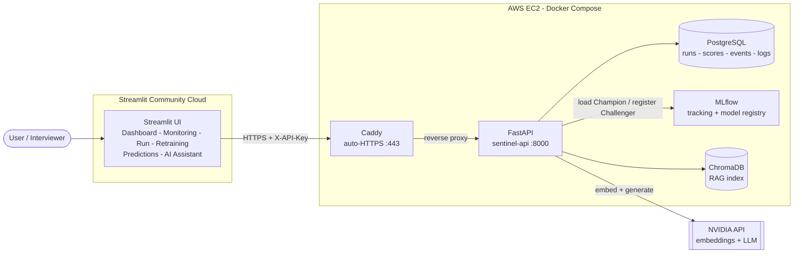
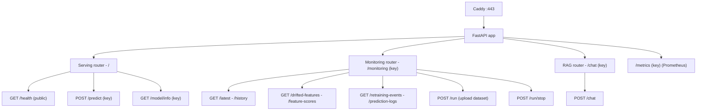
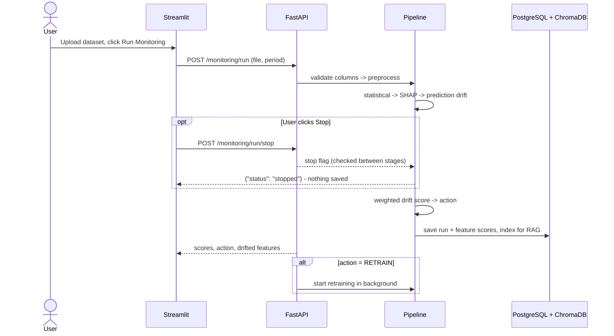
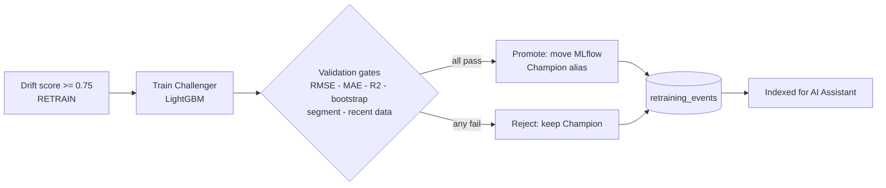

# 🛡️ Sentinel-AI

**A self-healing ML pipeline.** Sentinel-AI serves a LightGBM model that predicts NYC taxi trip duration. It watches production data for drift, decides on its own when the model needs retraining, retrains it, and promotes the new model only if it passes strict validation gates. An AI assistant (RAG) explains every decision in plain English.

> **Live demo:** the UI is always online, but the backend runs on AWS EC2 and is kept stopped to save cost. If the UI shows *Backend: Offline*, email **your.email@example.com** and I'll start it for you.

---

## What it does

| Step | What happens |
|---|---|
| **Serve** | FastAPI serves the current **Champion** model from the MLflow Model Registry and logs every prediction to PostgreSQL. |
| **Monitor** | Upload a month of production data. Three detectors compare it with the reference data: **statistical** (PSI / KS / JS), **SHAP** (feature-importance shift) and **prediction** drift. |
| **Decide** | A weighted drift score (0.4 · statistical + 0.3 · SHAP + 0.3 · prediction) maps to an action: `WAIT` < 0.25 ≤ `MONITOR` < 0.5 ≤ `ALERT` < 0.75 ≤ `RETRAIN`. |
| **Heal** | On `RETRAIN`, a **Challenger** model is trained and must pass the metric, bootstrap, segment and recent-data gates before it replaces the Champion. Otherwise it is rejected and the Champion stays. |
| **Explain** | Every monitoring run and retraining event is indexed in ChromaDB, so the AI Assistant can answer questions like *"Why was the challenger rejected?"* with cited sources. |

---

## Architecture



Only ports **80/443** are public. The API, PostgreSQL and MLflow have no public ports; they talk to each other on a private Docker network.

---

## API routing

Everything reaches the API through Caddy (`https://<host>/...` → `sentinel-api:8000`). Protected routes need the `X-API-Key` header.



| Method | Path | Auth | Purpose |
|---|---|---|---|
| GET | `/` | – | Service info |
| GET | `/health` | – | Liveness + whether the model is loaded |
| POST | `/predict` | 🔒 | Predict trip duration; logged to `prediction_logs` in the background |
| GET | `/model/info` | 🔒 | Champion version, metrics, load time |
| GET | `/monitoring/latest` | 🔒 | Latest monitoring run |
| GET | `/monitoring/history` | 🔒 | Past monitoring runs |
| GET | `/monitoring/drifted-features` | 🔒 | Features flagged in the latest run |
| GET | `/monitoring/feature-scores` | 🔒 | Per-feature PSI / KS / JS scores |
| GET | `/monitoring/retraining-events` | 🔒 | Retraining history (promoted / rejected, with reasons) |
| GET | `/monitoring/prediction-logs` | 🔒 | Recent predictions |
| POST | `/monitoring/run` | 🔒 | Upload a `.csv` / `.parquet` and run one monitoring cycle |
| POST | `/monitoring/run/stop` | 🔒 | Stop the run in progress (nothing is saved) |
| POST | `/chat` | 🔒 | Ask the AI Assistant (RAG over runs and events) |
| GET | `/metrics` | 🔒 | Prometheus metrics |

The API also enforces a CORS allowlist (`CORS_ALLOWED_ORIGINS`), a 300 MB upload limit, and one monitoring run at a time.

---

## Monitoring run flow



## Self-healing loop



---

## Tech stack

| Layer | Tools |
|---|---|
| Model | LightGBM, SHAP, scikit-learn, pandas, PyArrow |
| Drift detection | PSI, Kolmogorov–Smirnov, Jensen–Shannon, SHAP drift, prediction drift |
| MLOps | MLflow (tracking + registry with Champion alias), Prometheus metrics |
| API | FastAPI, Uvicorn, SQLAlchemy |
| Storage | PostgreSQL 15, ChromaDB |
| GenAI | RAG with NVIDIA embeddings + LLM, relevance threshold, cited sources |
| UI | Streamlit |
| Infra | Docker Compose, Caddy (HTTPS), AWS EC2, Streamlit Community Cloud |
| Testing | pytest (800+ tests, no external services needed) |

---

## Project layout

```
src/
  serving/      FastAPI app, /predict /health /model/info, auth, CORS, prediction logging
  api/routes/   /monitoring and /chat routers
  ingestion/    raw TLC data reading + preprocessing (shared by training and monitoring)
  monitoring/   drift detectors, drift runner, scorer, upload runs (with Stop)
  training/     retraining, promotion gates, MLflow logging, orchestrator
  evaluation/   bootstrap, segment and recent-data gates
  rag/          ChromaDB store, embeddings, retriever, LLM, index rebuild
  database/     PostgreSQL access and migrations
frontend/       Streamlit UI (views/ = pages, api_client.py = the only API caller)
deploy/         AWS EC2 deployment: compose override, Caddyfile, setup + data migration scripts
docker/mlflow/  MLflow server image
tests/          pytest suite
```

---

## Run locally

1. Copy `.env.example` to `.env` and set `API_KEY`, the PostgreSQL settings and `NVIDIA_API_KEY`.
2. Start the backend (API, PostgreSQL, MLflow):

   ```bash
   docker compose up -d --build
   ```

3. Start the UI (set `SENTINEL_API_URL` and `SENTINEL_API_KEY` in `frontend/.env`):

   ```bash
   cd frontend && streamlit run app.py
   ```

4. Run the tests:

   ```bash
   pytest
   ```

| Service | Local URL |
|---|---|
| API docs | http://localhost:8000/docs |
| MLflow | http://localhost:5000 |
| Streamlit | http://localhost:8501 |

## Deploy

See [deploy/README.md](deploy/README.md) for the AWS EC2 setup (Caddy HTTPS, data migration) and [frontend/README.md](frontend/README.md) for the Streamlit UI.

## License

See [LICENSE](LICENSE).
